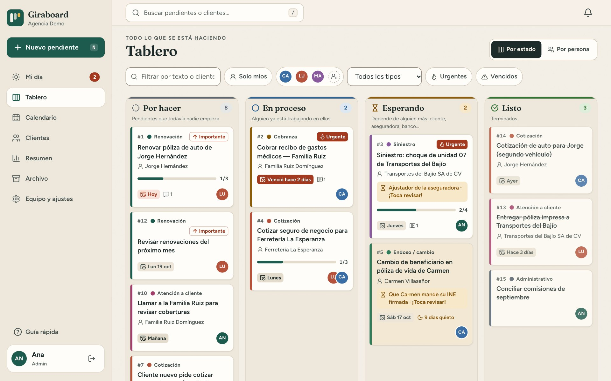
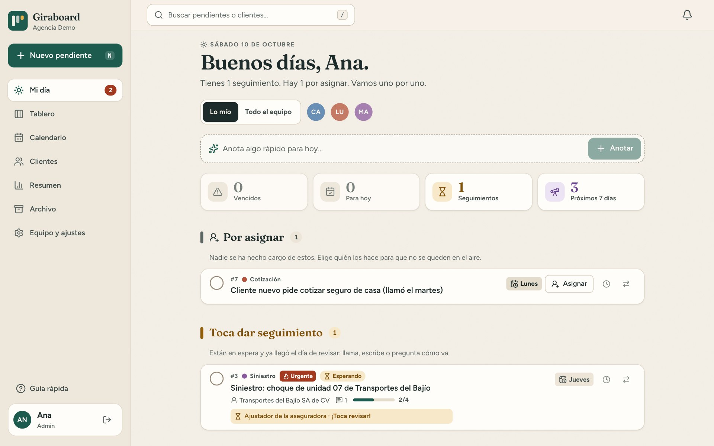
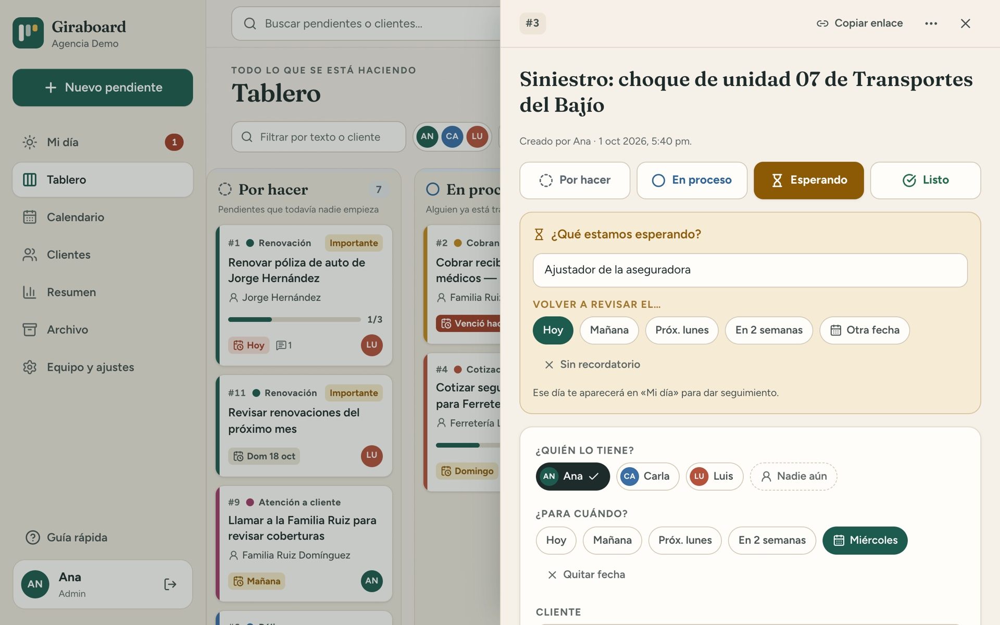
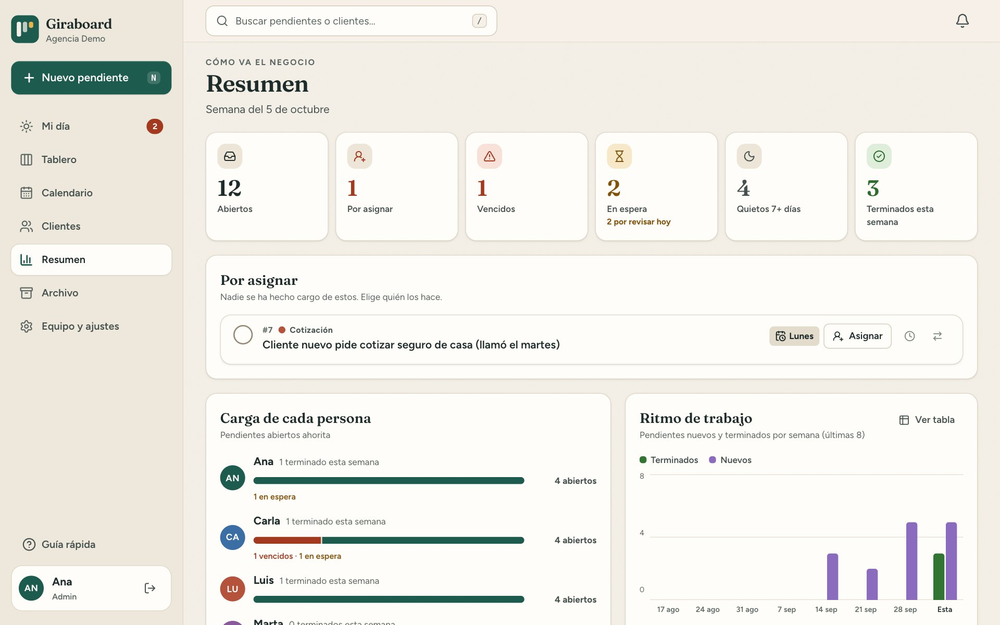
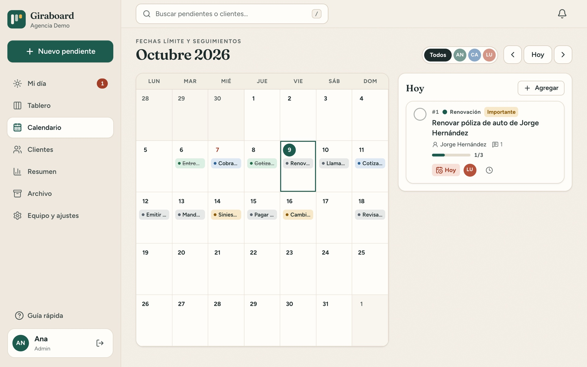
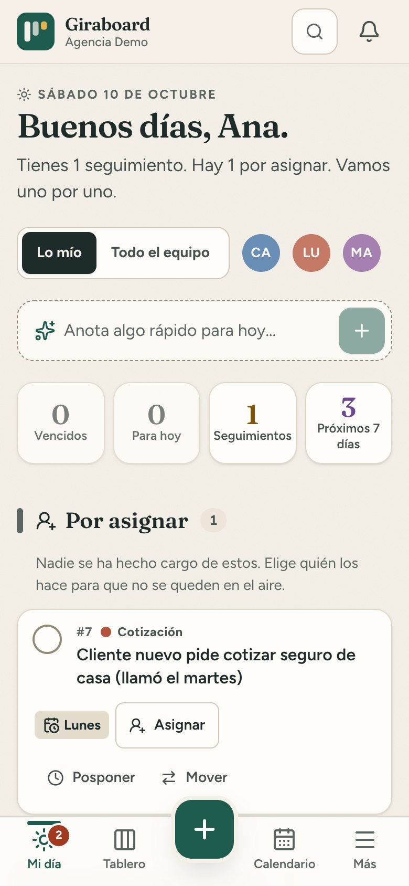
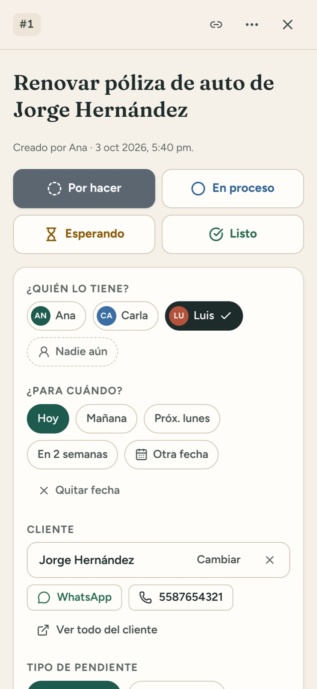

<div align="center">


# Giraboard

**The open-source task board that keeps small offices from forgetting things.**

Who has what, by when, and how it's going — in one place your whole team can actually use.

[](https://github.com/vidzza/giraboard/actions/workflows/ci.yml)
[](LICENSE)


[**Leer en español**](README.es.md) · [Deployment guide](docs/DEPLOYMENT.md) · [Design notes](docs/DESIGN.md)



</div>

## Why Giraboard?

In most small offices (insurance agencies, accounting firms, real-estate agencies, clinics, family businesses) the to-do list lives in WhatsApp chats, sticky notes and the owner's memory. Things fall through the cracks: a renewal nobody followed up on, a client still waiting for an answer, a payment that was never chased.

Big project-management tools are built for software teams and feel overwhelming to everyone else. Giraboard is the opposite. It's a **calm, very simple board designed for non-technical people**, with a few features built specifically so that **nothing gets forgotten**:

- **My Day** opens every morning with what's overdue, what's due today and which follow-ups are due. There's a one-click **Snooze** for anything that can wait.
- **"Waiting on…" as a first-class status.** When something depends on a client, a carrier or a bank, you write *what* you're waiting for and *when to check again*. That day it pops back up.
- **Stale cards look stale.** Anything untouched for 7+ days turns yellow and says so.
- **Recurring tasks** (monthly reports, rent, renewals) recreate themselves when completed.
- **Everything leaves a trail.** Each task keeps a timeline of notes and changes ("Luis moved it to *Waiting* · 2 h ago"), so anyone can pick it up.

## Features

| | |
|---|---|
| 🗓️ **My Day** | Overdue, due today, follow-ups, checklist steps assigned to you, next 7 days, what you delegated and what you're copied on. |
| 📥 **Unassigned inbox** | Tasks nobody has taken land in an inbox for admins and managers, with a one-tap "Assign" button. Nothing is left without an owner. |
| 🗂️ **Board** | Four clear statuses (*To do · In progress · Waiting · Done*), drag & drop or a "Move" button, a per-person view and filters. One column at a time on phones. |
| 📋 **Task detail** | **Multiple assignees**, **followers**, due date, client, type, priority, recurrence, notes, **checklist steps with owners and a progress bar**, attachments and a full timeline. |
| 👥 **Clients** | Every task linked to a client, with history and one-tap **WhatsApp** / call buttons. |
| 📅 **Calendar** | Due dates and follow-ups by month. |
| 📊 **Overview** | Workload per person, what's been waiting longest, stale tasks, weekly throughput and a team activity feed. |
| 🔔 **Real-time & reminders** | Live updates across screens, in-app and browser notifications, @mentions and daily reminders for due tasks and follow-ups. |
| 🔐 **Roles & permissions** | **Admin**, **Manager** (sees everything, assigns work) and **Team** (sees only their own work), enforced server-side. Only admins delete. Temporary passwords and terminal recovery. |
| 💾 **Your data** | Single SQLite file, automatic daily backups, one-click backup download and CSV export for Excel. |
| 📱 **Works everywhere** | Built for phones (large targets, bottom-sheet menus, no zoom-on-focus) and desktops (`N` new task, `/` search). **Light, dark or automatic** theme with accessible (WCAG AA) colors. |

<table>
  <tr>
    <td width="50%"><p align="center"><b>My Day</b>: what needs attention now</p></td>
    <td width="50%"><p align="center"><b>Task detail</b> with “waiting on” and follow-up date</p></td>
  </tr>
  <tr>
    <td width="50%"><p align="center"><b>Overview</b> for the owner</p></td>
    <td width="50%"><p align="center"><b>Calendar</b> of due dates and follow-ups</p></td>
  </tr>
</table>

<p align="center">
  
  &nbsp;&nbsp;
  
</p>

## Make it yours

Nothing is hard-coded to a particular business. On first run, the admin:

1. Names the business.
2. Picks a starter set of task types (**General**, **Insurance agency**, **Accounting firm**, **Real estate** or **empty**). They're fully editable later.
3. Gets the time zone from the browser automatically (it can be changed in *Settings* and drives "today", "overdue" and reminder times).

Then they add teammates, each with their own login so every action is attributed.

> The interface is currently in **Spanish (es-MX)**. English and other translations are very welcome; see [Contributing](CONTRIBUTING.md).

## Try it locally

Requires **Node.js 24+**.

```bash
git clone https://github.com/vidzza/giraboard.git
cd giraboard
npm install
npm run probar
```

Open http://localhost:5173 and sign in with a demo user: `ana` (admin), `marta` (manager), `luis` or `carla` (team), password `demo1234`. The demo data is fictional.

Run the automated permission tests with `npm test`.

To see the first-run experience instead (empty install, setup screen):

```bash
npm run build && DATA_DIR=/tmp/giraboard-empty npm start
```

Then open http://localhost:3000. The setup code is printed in the terminal.

## Self-host it

Giraboard is a **single Node.js process with an embedded SQLite database**. There's nothing else to install, and it runs happily on a $5 VPS or a Raspberry Pi. One command installs it as a `systemd` service with automatic HTTPS via [Caddy](https://caddyserver.com):

```bash
sudo ./deploy/install.sh tasks.your-domain.com
```

There are also modes for a **Raspberry Pi behind Cloudflare Tunnel** (`--tunel`, no open ports) and **office LAN only** (`--red-local`). It starts on boot, one machine can host **several independent boards** (`--nombre sales --puerto 3001`), and `--actualizar` updates all of them after an automatic backup.

See the full **[deployment guide](docs/DEPLOYMENT.md)** for DNS, first-run setup, backups, updates and troubleshooting.

**Security out of the box:**

- scrypt password hashing and HttpOnly session cookies
- Login rate limiting and CSRF protection
- Strict security headers and CSP
- A one-time setup code, so nobody can claim a fresh install before you do
- Sandboxed file downloads and `noindex`
- An unprivileged, sandboxed systemd service

## Tech stack

| Layer | Tools |
|---|---|
| Server | [Hono](https://hono.dev) on Node.js 24, built-in `node:sqlite`, Zod, Server-Sent Events. TypeScript runs directly (Node type stripping), no build step. |
| Web | React 19, Vite, Tailwind CSS 4, TanStack Query, React Router, dnd-kit, date-fns, Sonner |
| Ops | systemd + Caddy, daily SQLite backups (`VACUUM INTO`), admin CLI |

```
server/    API, auth, reminders, backups, admin CLI (server/cli.ts)
web/       React app (pages/, components/, lib/)
shared/    Types and labels shared by server and web
deploy/    install.sh: install & update on Debian / Ubuntu / Raspberry Pi OS
docs/      Deployment guide, design notes and screenshots
```

Useful scripts: `npm run dev`, `npm run build`, `npm start`, `npm run seed -- --reset`, `npm run admin -- usuarios`, `npm run typecheck`.

## Roadmap ideas

- English UI (i18n)
- Daily email / WhatsApp digest per person
- Web push notifications for installed mobile apps
- Import client lists and recurring deadlines from CSV

Have an idea? [Open an issue](https://github.com/vidzza/giraboard/issues).

## Contributing

Bug reports, translations and pull requests are welcome. Read [CONTRIBUTING.md](CONTRIBUTING.md) to get started, and [SECURITY.md](SECURITY.md) to report vulnerabilities privately.

## License

[MIT](LICENSE). Free to use, modify and self-host, including commercially.
